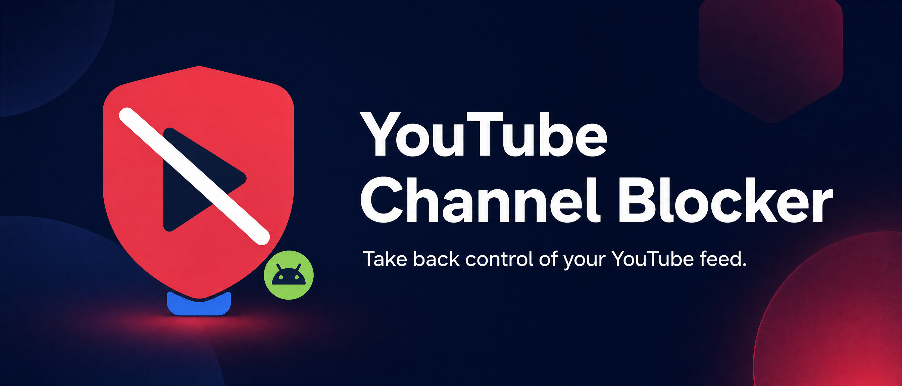
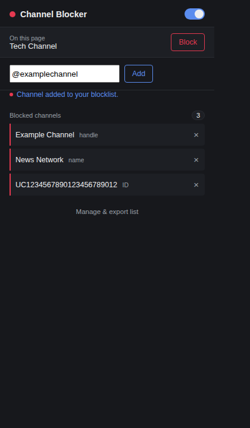
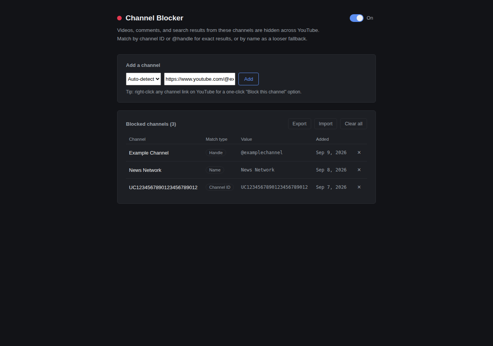

# YouTube Channel Blocker

**Documentation:** English | [العربية](README_AR.md) · [Changelog](CHANGELOG.md) | [سجل التغييرات بالعربية](CHANGELOG_AR.md)



A lightweight browser extension for hiding videos, comments, search results, channel cards, playlists, and other YouTube content from channels you choose to block.

The extension uses Manifest V3 and stores the blocklist with `chrome.storage.sync`, allowing it to follow the signed-in browser profile across supported Chromium browsers.

## Preview

The toolbar popup provides a quick way to add channels, inspect the current page, toggle filtering, and remove entries from the synchronized blocklist.



The full options page provides the blocklist manager, matching-type controls, import/export actions, and a global enable/disable switch.



## Features

- Block channels by channel ID, `@handle`, or display name.
- Hide blocked content from feeds, search results, watch pages, channel pages, playlists, Shorts-related cards, and comments.
- Replace a blocked channel's direct channel, Videos, Shorts, Live, and Community pages with a blocked notice.
- Hide supported post/video cards that link to a blocked channel, including cards that mention a blocked channel as a collaborator.
- Replace a blocked channel's watch-page player with a clear notice and an **Unblock and watch** action; pause and mute playback while it is blocked.
- Block channels through the toolbar popup, a right-click context menu, or a hover action on supported cards.
- Add a channel link, handle, ID, or name manually.
- Manage, remove, import, and export blocked channels from the options page.
- Temporarily block channels, add allowlist exceptions, organize entries with categories and notes, and undo recent actions.
- Search, sort, bulk-select, export, and remove entries; import/export JSON or CSV, including channel metadata.
- Filter videos by title keywords or phrases, using substring or whole-word matching.
- Choose whether blocked cards are hidden or replaced with a notice, and view a locally stored approximate filtered-item count.
- Enable or disable filtering globally without deleting the blocklist.
- Use the same source package in Chrome, Microsoft Edge, Brave, and other Chromium-based browsers that support Manifest V3.

## What's new in 2.0.0

Version 2.0.0 brings together the feature releases made since 1.1.0: channel-page and related-card filtering, more reliable blocked watch pages, improved blocklist management, JSON/CSV import and export, temporary blocks and allowlists, categories and notes, undo and local statistics, and title-keyword filtering. It also aligns package versions and provides version-derived desktop and Android build artifacts. See the full [changelog](CHANGELOG.md).

## Installation and updates

### Desktop (Chromium browsers)

Download `youtube-channel-blocker-desktop-v2.0.0.zip` from the completed GitHub Actions workflow artifacts, then extract it to a stable folder. Open `chrome://extensions` (Chrome), `edge://extensions` (Edge), or `brave://extensions` (Brave), enable **Developer mode**, choose **Load unpacked**, and select the extracted folder containing `manifest.json`.

To update, extract the newer package to the same stable folder and select **Reload** on the extensions page. Avoid loading a second copy from another folder. The blocklist is kept in browser extension storage; do not clear browser extension data when updating.

### Firefox for Android

Use the Android package from the workflow artifacts. It targets Firefox for Android 142 or newer. Depending on the Firefox release channel, sideloading may require temporary loading or additional setup. Permanent distribution requires signing through Mozilla Add-ons.

### Development install

1. Clone or download this repository.
2. Open your browser's extensions page:
   - Chrome: `chrome://extensions`
   - Edge: `edge://extensions`
   - Brave: `brave://extensions`
3. Enable **Developer mode**.
4. Select **Load unpacked**.
5. Choose the repository root, which is the directory containing `manifest.json`.
6. Open YouTube and use the extension from the browser toolbar.

After changing source files, return to the extensions page and select **Reload** for the extension.

Firefox supports temporary loading through `about:debugging` and **Load Temporary Add-on**. A permanent Firefox installation requires the extension to be signed through Mozilla Add-ons.

## Usage

### Block a channel from YouTube

Right-click a channel link and select **Block this YouTube channel**. The extension displays a confirmation prompt before saving the channel.

You can also hover over a supported video or channel card and select the block button, or open the extension popup and select **Block** for the channel detected on the current YouTube page.

### Add a channel manually

The popup and options page accept any of the following inputs:

| Input | Example | Matching behavior |
| --- | --- | --- |
| Channel ID | `UCxxxxxxxxxxxxxxxxxxxxxx` | Exact channel ID match |
| Handle | `@example` | Exact handle match |
| Channel URL | `https://www.youtube.com/@example` | Extracts the channel handle or ID |
| Display name | `Example Channel` | Case-insensitive substring match |

Name-based matching is intentionally flexible. It can match more than one similarly named channel, so channel IDs and handles are recommended when exact matching matters.

## Project structure

| File or directory | Purpose |
| --- | --- |
| `manifest.json` | Manifest V3 metadata, permissions, scripts, icons, and browser entry points |
| `platforms/web/manifest.json`, `platforms/android/manifest.json` | Platform-specific package manifests |
| `background.js` | Service worker for context-menu actions |
| `common.js` | Shared normalization and synchronized-storage helpers |
| `content.js` | YouTube DOM scanning, filtering, overlays, and block controls |
| `content.css` | Styles for injected buttons, dialogs, and blocked-player notices |
| `popup.html`, `popup.js`, `popup.css` | Toolbar popup interface |
| `options.html`, `options.js`, `options.css` | Full blocklist manager and import/export interface |
| `icons/` | Browser action icons |
| `assets/logos/` | Platform-specific Firefox Desktop and Firefox for Android logos |
| `assets/youtube-channel-blocker-banner.png` | Repository and store-listing banner |
| `.github/workflows/build-extension.yml` | Automated validation and ZIP packaging workflow |
| `README.md`, `README_AR.md` | English and Arabic documentation |
| `CHANGELOG.md`, `CHANGELOG_AR.md` | English and Arabic release history |

## Build locally

The extension does not require dependency installation or a bundler. Its source files can be loaded directly by a browser.

To validate the source and produce versioned desktop and Android ZIP packages on Linux or macOS, run:

```bash
python3 -m json.tool manifest.json >/dev/null
python3 -m json.tool platforms/web/manifest.json >/dev/null
python3 -m json.tool platforms/android/manifest.json >/dev/null
for file in *.js; do node --check "$file"; done
bash build-extensions.sh
```

The versioned packages are written to `dist/`; `dist/youtube-channel-blocker.zip` is refreshed as a compatibility alias for the desktop package. For browser development, load the repository directory itself rather than the ZIP file.

## Automated builds

Every push to `main` and every pull request runs the GitHub Actions workflow. The workflow validates the manifests, checks JavaScript syntax with Node.js, verifies the required files, and builds separate desktop and Android packages.

To download a build, open the completed workflow run on GitHub. In the **Artifacts** section, download `youtube-channel-blocker-desktop-v<version>` or `youtube-channel-blocker-android-v<version>`; each contains the matching platform ZIP. The artifact names and filenames are derived from the synchronized manifest version.

## Privacy and permissions

The extension does not send the blocklist to a third-party server. It uses the browser's synchronized extension storage so the list can be available to the same browser profile on supported devices.

| Permission | Purpose |
| --- | --- |
| `storage` | Save the blocklist and enabled/disabled state |
| `contextMenus` | Add the channel-blocking right-click actions |
| `activeTab` | Inspect the active YouTube tab from the popup |
| `scripting` | Detect the current channel in the active tab |
| YouTube host access | Scan and filter YouTube pages |

The extension only operates on YouTube pages covered by its manifest matches and host permissions.

## Known limitations

YouTube changes its page structure regularly. If a particular card type stops being filtered, the relevant selector in `content.js` may need to be updated. Collaboration filtering is based on channel links present in a card; YouTube does not expose a consistent collaborator identity on every surface, so cards that do not link to or identify the blocked channel cannot always be detected.

Name matching is based on visible text and is less precise than matching a channel ID or handle. The extension is designed for client-side filtering: on a blocked channel's own page it covers the page with a notice, while on other pages it hides supported matching cards. It does not prevent YouTube from downloading content, block content outside YouTube, or guarantee detection on every YouTube surface.

## Contributing

Bug reports and improvements are welcome. When reporting a filtering issue, include the YouTube page type, the browser and version, and the relevant channel URL if possible. Do not include private account information or authentication details.

## License

This project is licensed under the MIT License. See [`LICENSE`](LICENSE) for the complete license text.
